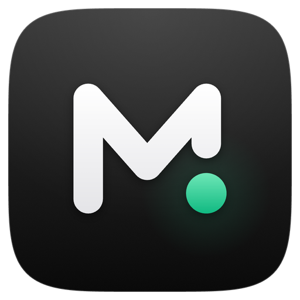
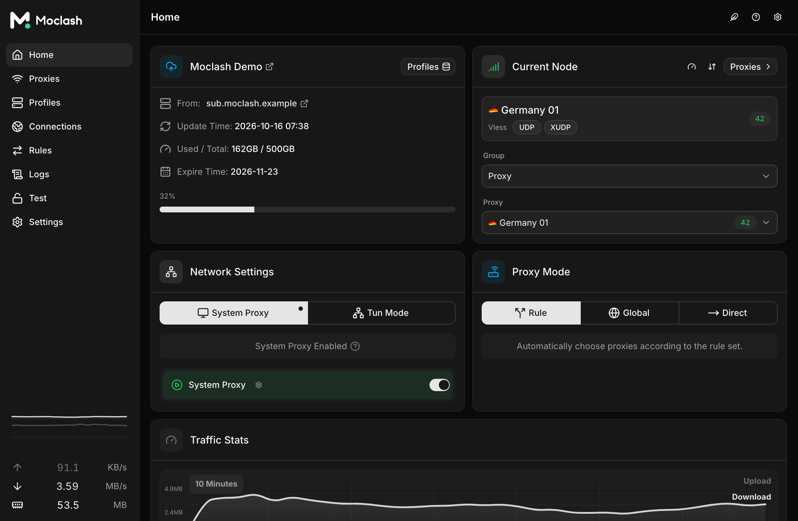
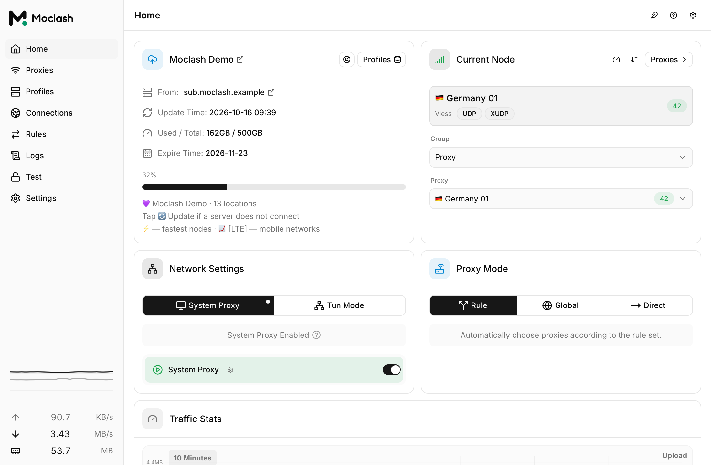
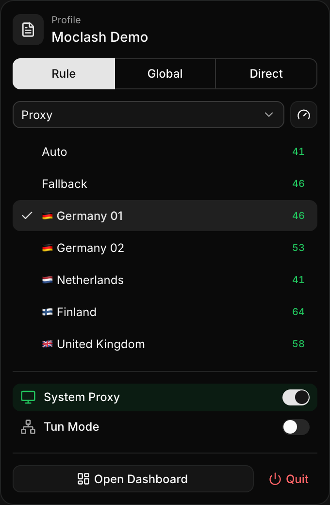

<h1 align="center">
  
  <br>
  Moclash
  <br>
</h1>

<h3 align="center">
A desktop Mihomo (Clash.Meta) GUI built with <a href="https://github.com/tauri-apps/tauri">Tauri 2</a> and Rust.
</h3>

## Preview

| Dark                                  | Light                                   |
| ------------------------------------- | --------------------------------------- |
|  |  |

## Install

Download the installer for your platform from the
[Releases page](https://github.com/moltea/moclash-rev/releases). Windows
(x64/arm64), macOS (Apple Silicon/Intel) and Linux (x64/arm64/armv7) are
supported.

| Channel | Description                                                                         | Link                                                                    |
| :------ | :---------------------------------------------------------------------------------- | :---------------------------------------------------------------------- |
| Stable  | Tagged releases, recommended for daily use.                                         | [Releases](https://github.com/moltea/moclash-rev/releases)              |
| Nightly | "Moclash Nightly", rebuilt on every push to `dev`. Latest changes, may have bugs. | [Nightly](https://github.com/moltea/moclash-rev/releases/tag/autobuild) |

Nightly assets:

- **Windows:** x64 and arm64 setup installers, plus variants bundling a fixed
  WebView2 runtime.
- **macOS:** `.dmg` for Apple Silicon (aarch64) and Intel (x64).
- **Linux:** `.deb` and `.rpm` for x64, arm64 and armv7.

> [!NOTE]
> Assets are named after the product name **Moclash** (for example
> `Moclash_<version>_x64-setup.exe`, `Moclash_<version>_aarch64.dmg`,
> `Moclash_<version>_amd64.deb`, `Moclash-<version>-1.x86_64.rpm`), and the
> app is installed and shown as "Moclash".

macOS builds are ad-hoc signed but not notarized. On first launch macOS may say
that it cannot verify the developer: open **System Settings → Privacy &
Security** and click **Open Anyway**. If macOS still reports that the app is
damaged, clear the quarantine attribute:

```shell
xattr -cr "/Applications/Moclash.app"
```

## Features

- Built on Rust and Tauri 2.
- Bundled [Mihomo (Clash.Meta)](https://github.com/MetaCubeX/mihomo) core, with
  optional switching to the `Alpha` core.
- New interface built with [shadcn/ui](https://ui.shadcn.com) (Radix, Tailwind
  CSS v4, lucide icons).
- Profile management and enhancement (Merge and Script), with configuration
  syntax hints.
- Visual proxy, rule and proxy-group editors.
- System proxy with guard, and `TUN` (virtual network adapter) mode.
- WebDAV backup and sync.
- Custom theme colors, proxy-group and tray icons, and `CSS Injection`.
- Tray quick panel for switching the proxy mode and server without opening
  the main window (see below), plus the tray menu and global hotkeys.
- **Send HWID** for subscriptions that enforce device limits (see below).

## Tray quick panel

<p align="center">
  
</p>

Left-clicking the Moclash tray icon opens a small quick panel next to the icon
instead of the main window. From it you can:

- switch the proxy mode between **Rule**, **Global** and **Direct**;
- pick a server in any selector group of the current profile, with live
  latency badges and a latency test button;
- toggle **System Proxy** and **TUN** mode;
- open the full dashboard or quit Moclash.

The panel closes when it loses focus or when you press `Esc`. It also works in
lightweight mode, which closes the main window to save memory while the core,
system proxy and tray keep running. On Linux desktops whose tray does not
report clicks, open it from the tray menu with **Quick Panel**. To get the old
behaviour back, change **Settings → Tray Click Event** to "Show Main Window".

## Send HWID

Some subscription panels, such as Remnawave, limit how many devices may use a
subscription and identify devices by Happ-style request headers. When
the global **Send HWID** setting is enabled, Moclash sends these headers when
downloading or updating subscriptions:

| Header           | Value                                    |
| :--------------- | :--------------------------------------- |
| `x-hwid`         | Device identifier (see below)            |
| `x-device-os`    | `Windows`, `macOS` or `Linux`            |
| `x-ver-os`       | Operating system version                 |
| `x-device-model` | Device model reported by the OS          |

The HWID is derived from the operating system's machine ID (Windows
`MachineGuid`, macOS `IOPlatformUUID`, Linux `machine-id`), hashed with SHA-256
and shortened to 16 hex characters, so the raw machine ID never leaves the
device. You can override it with a custom HWID in the same settings section.
The setting is off by default.

## Development

See [CONTRIBUTING.md](./CONTRIBUTING.md) for prerequisites and details.

After all prerequisites for **Tauri** are installed, run:

```shell
pnpm i
pnpm run prebuild
pnpm dev
```

`pnpm dev` preserves the Development Channel's installed service state: an
existing service is used, while a previously uninstalled service remains
uninstalled and the app starts in Sidecar mode. Use `pnpm dev:service` to
explicitly install or update the isolated development service before launch,
or `pnpm dev:sidecar` to force the unprivileged Sidecar workflow.

### Frontend layout

| Directory | Interface                                        | Scripts                          |
| :-------- | :----------------------------------------------- | :------------------------------- |
| `ui/`     | New shadcn/ui interface, used by Tauri           | `pnpm ui:dev`, `pnpm ui:build`   |
| `src/`    | Original MUI interface, kept as a fallback       | `pnpm web:dev`, `pnpm web:build` |

`pnpm ui:dev` starts only the web UI dev server, without the Tauri shell.

## Contributing

Issues and pull requests are welcome. Please read
[CONTRIBUTING.md](./CONTRIBUTING.md) first.

## Acknowledgements

Moclash is a fork of
[Clash Verge Rev](https://github.com/clash-verge-rev/clash-verge-rev), and is
based on or inspired by these projects:

- [zzzgydi/clash-verge](https://github.com/zzzgydi/clash-verge): A Clash GUI
  based on Tauri.
- [tauri-apps/tauri](https://github.com/tauri-apps/tauri): Build smaller,
  faster, and more secure desktop applications with a web frontend.
- [MetaCubeX/mihomo](https://github.com/MetaCubeX/mihomo): A rule-based tunnel
  in Go.
- [shadcn/ui](https://github.com/shadcn-ui/ui): Accessible, customizable
  components the new interface is built with.

## Privacy

Moclash collects no user data; configuration and logs stay on your device. See
the [Privacy Policy](./PRIVACY.md) for details.

## License

GPL-3.0 License. See [LICENSE](./LICENSE) for details.
